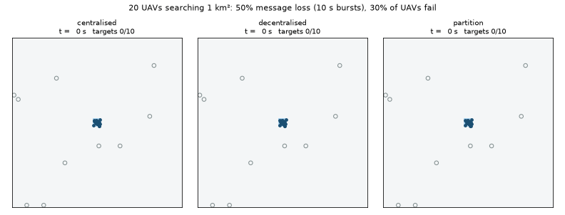
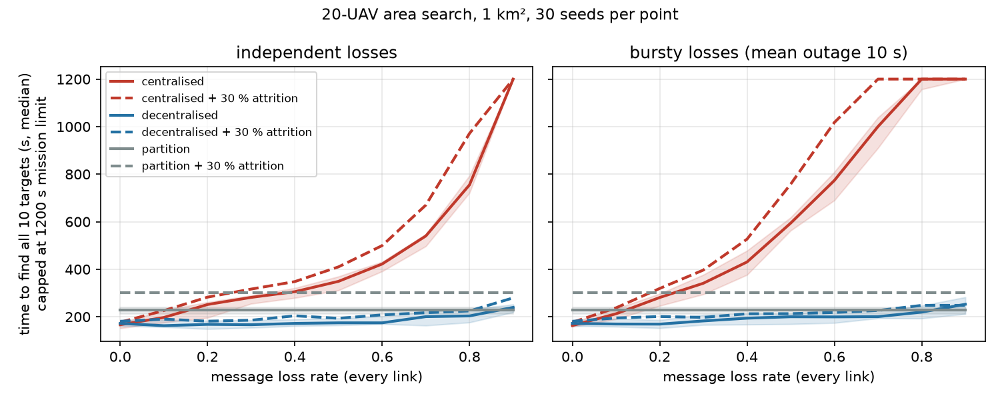

# swarm-dil

**How much does a degraded network cost a UAV swarm's search mission, and which coordination scheme survives it?**



## Operational problem

Swarm coordination algorithms are usually published with perfect communications. In the field the network is **DIL**: *disconnected, intermittent, limited*. Links drop in bursts, the mesh partitions, the link back to command fades, and vehicles are lost. A coordination scheme that only works with a healthy network is a liability in exactly the situations (search and rescue after a disaster, contested or remote areas) where swarms are most useful.

`swarm-dil` measures this with **mission metrics** (time to find every target), not network metrics (latency, packets delivered).

## Method

- **Mission:** 20 UAVs search a 1 km × 1 km area (40 × 40 cells of 25 m, one cell = sensor footprint) for 10 hidden targets. Speed 10 m/s, launch from the centre, 1 s time step, 20-minute limit.
- **Link model** ([`link.py`](src/swarm_dil/link.py)): each directed link has its own channel with a set long-run loss rate. Losses are either independent, or **bursty** (Gilbert-Elliott channel with a mean outage of 10 s). Agent-to-agent links are also limited to 300 m.
- **Attrition:** optionally, 30 % of UAVs fail at random times during the first 5 minutes.
- **Strategies** ([`sim.py`](src/swarm_dil/sim.py)):
  | Strategy | Communication | Decision |
  |---|---|---|
  | `centralised` | UAV ↔ C2 node; **unlimited range**, loss only | C2 assigns each UAV the nearest unsearched, unassigned cell; a UAV without a fresh order holds its last goal |
  | `decentralised` | UAV ↔ UAV mesh, 300 m range | Each UAV merges the coverage maps it hears, claims a cell, and yields if a closer neighbour claims the same one (single-task auction) |
  | `partition` | none | Each UAV sweeps a strip assigned before launch, then searches anything it has not seen itself |
- **Sweep:** loss 0–90 % × {independent, bursty} × {no attrition, 30 % attrition} × 3 strategies × 30 seeds = 3,600 missions.

The centralised baseline is deliberately generous: its C2 link never runs out of range.

## Results



| Median time to find all 10 targets (s) | 0 % loss | 50 % loss, bursty | 90 % loss, bursty |
|---|---|---|---|
| centralised | 163 | 594 (**3.6×**) | >1200: 7 % of missions finish |
| decentralised | 172 | 200 (**1.16×**) | 252, 100 % finish |
| partition (no comms) | 229 | 229 | 229 |

1. **Centralised coordination is the fastest with a healthy network and the most fragile without one.** With half of messages lost in 10 s bursts it takes 3.6× longer. At 90 % loss it finishes only 7 % of missions within 20 minutes, even though its link never runs out of range.
2. **Between 10 % and 20 % message loss, a centrally coordinated swarm is already slower than one that does not communicate at all** (pre-assigned strips).
3. **Mesh-based decentralised coordination degrades gracefully.** It loses 16 % at 50 % bursty loss and 47 % at 90 %, completes every mission in every condition tested, and absorbs 30 % attrition. Pre-assigned strips are immune to loss but leave the strips of failed UAVs unsearched until survivors stumble into them: 30 % attrition costs +31 % time, and 3 % of missions do not finish.
4. **Bursts hurt more than independent losses at the same average rate** (centralised at 50 % loss: 349 s independent against 594 s bursty). Testing with i.i.d. packet loss underestimates the damage.

Full table: [`results/summary.md`](results/summary.md). Raw data: [`results/sweep.csv`](results/sweep.csv).

## Limitations

- **"Limited" is not modelled yet.** Messages have no size or bandwidth cost: decentralised UAVs exchange full coverage maps every second. This flatters the mesh strategy; bandwidth-aware messaging is the next project in the roadmap.
- Kinematic point-mass vehicles: no collision avoidance, wind, energy or sensor misses (detection is certain inside the cell).
- Range-free loss for the C2 link and a fixed 300 m mesh range; no terrain occlusion and no latency beyond the 1 s step.
- Simple coordination schemes. CBBA and recent methods such as CC-OPI ([arXiv:2609.19208](https://arxiv.org/abs/2609.19208)) are better allocators and are planned as baselines; the point here is the effect of the network on the mission.

## Reproduce

```bash
python -m venv .venv && source .venv/bin/activate   # Windows: .venv\Scripts\activate
pip install -e ".[plot,test]"
pytest                                  # 10 tests, ~5 s
python experiments/sweep.py             # 3,600 missions, ~5 min on 6 cores -> results/
python experiments/animate.py           # results/search_dil.gif
```

Every mission is seeded (`run(strategy, Scenario(...), seed)`), so results are bit-for-bit reproducible.

### Watch a run in TAK

`stream_cot.py` replays a mission as **Cursor on Target** events. UAVs appear as friendly UAV tracks and located targets as neutral ground points, on the standard TAK situational-awareness multicast group (`239.2.3.1:6969`), so ATAK, WinTAK or iTAK on the same LAN display it with no server:

```bash
python experiments/stream_cot.py --strategy decentralised --speedup 10
```

Coordinates are synthetic: an arbitrary 1 km square in an unpopulated mountain area.

## Use as a library

```python
from swarm_dil import Scenario, run
r = run("decentralised", Scenario(loss=0.5, burst=10, attrition=0.3), seed=0)
r.time_all_found, r.coverage[299]   # seconds, fraction searched after 5 min
```

## Responsible use

This is open research by Ropera Labs on the coordination of autonomous systems over degraded networks, aimed at dual-use applications such as search and rescue, emergency response and infrastructure inspection. It uses only synthetic data and public-domain methods, contains no weapon, targeting or vehicle-specific control code, and is not export-controlled technology as far as we are aware (basic research and public-domain information under Regulation (EU) 2021/821). Please use it in line with international humanitarian law and your local regulations.

## Licence

MIT © 2026 Ropera Labs. Part of the Ropera Labs roadmap on distributed autonomy and C4ISR for degraded networks.
