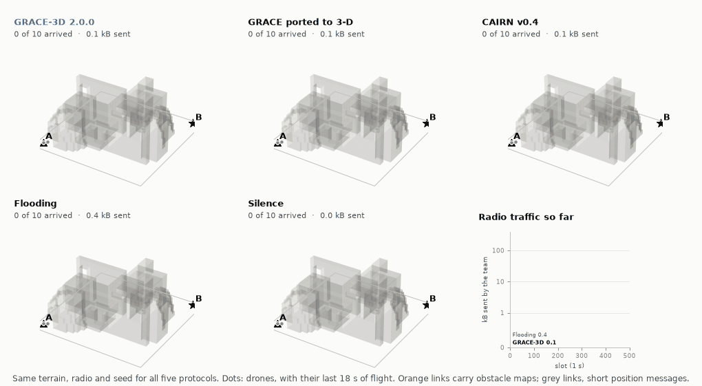
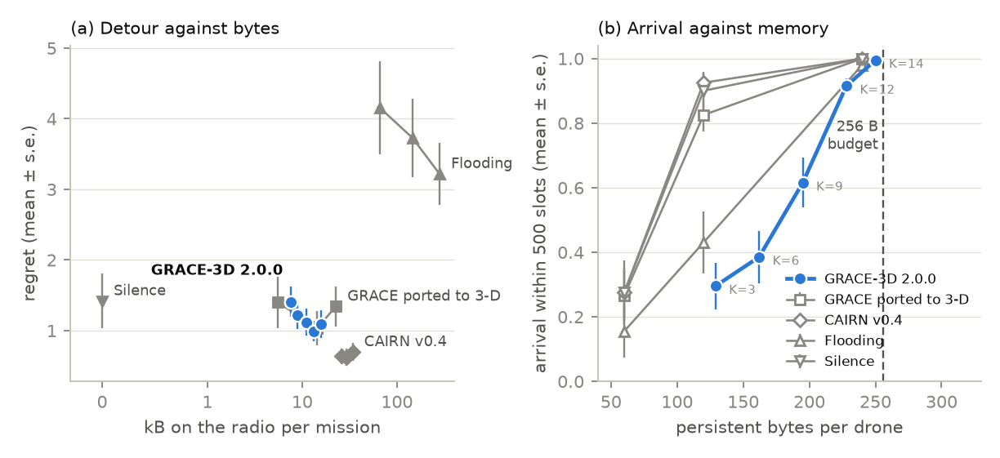
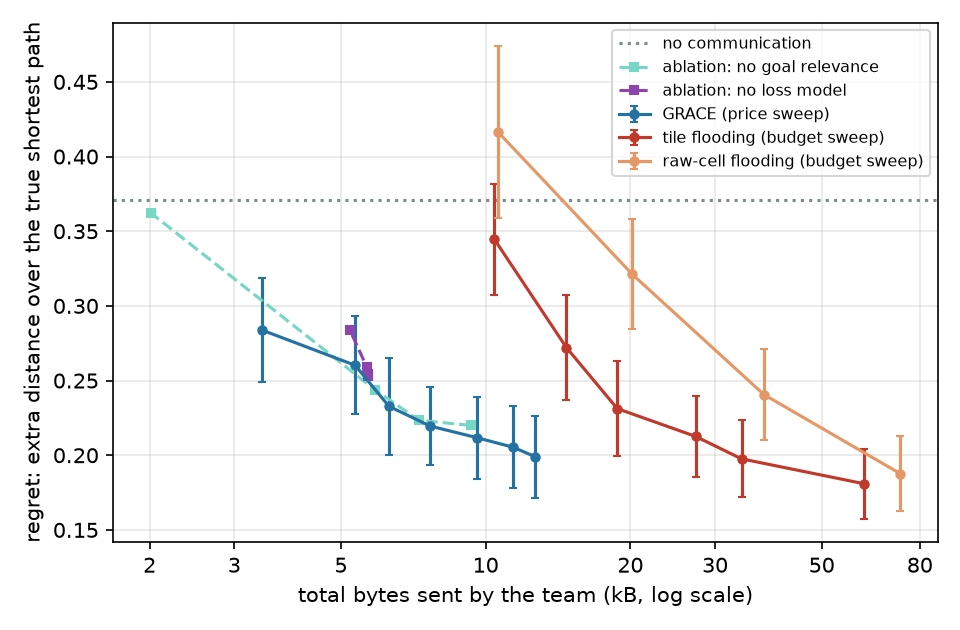
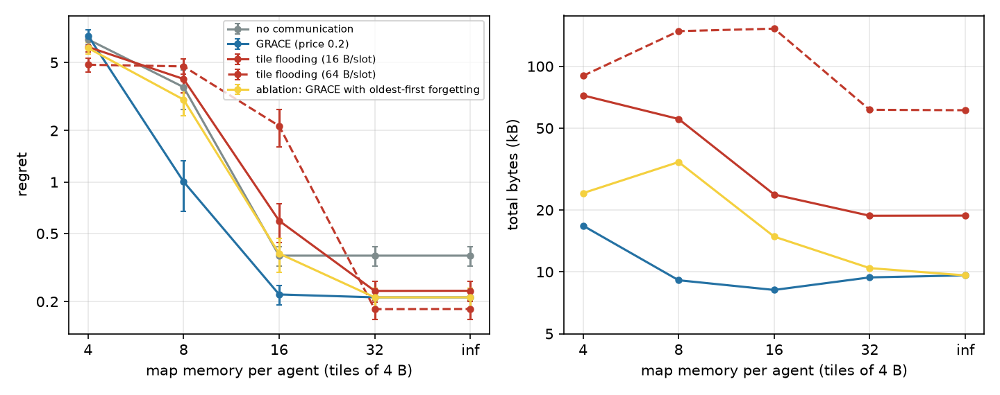
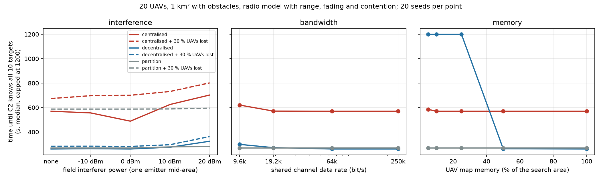

# swarm-dil

**Coordination and communication of memory- and bandwidth-limited UAV teams over degraded (DIL: disconnected, intermittent, limited) links.**

| Version | Question | Main result |
|---|---|---|
| **v2.0.0** (this) | Does GRACE survive the jump to 3-D on a microcontroller budget: 256 bytes of state, 1 ms per step, no GNSS? | **GRACE-3D 2.0.0**: 228 bytes of state, at most 0.74 ms per slot (operation-count model), 0 bytes of global coordinates, and the regret of GRACE ported to 3-D given 120 bytes of map alone, with every bound proved and the structural core checked in Lean 4 |
| [v0.3](../../tree/v0.3.0) | Which information should agents with tiny memories exchange, in how many bytes and how often, to cross unknown terrain from A to B? | **GRACE**, a protocol derived from the receivers' navigation decisions: same detour as flooding with **~3× fewer bytes**, and unlimited-memory performance with **64 bytes of map memory** |
| [v0.2](../../tree/v0.2.0) | Which coordination architecture survives a realistic radio, terrain, interference and bounded memory in an area search? | A single ridge makes central control 2.2× slower than a mesh |
| [v0.1](../../tree/v0.1.0) | How much does message loss cost a search mission? | Bursty loss of 50 % makes central control 3.6× slower |

# v2.0.0: GRACE-3D 2.0.0, in 228 bytes and 1 ms per slot

📄 **[Technical report RL-TR-2026-04 (PDF, 30 pages): model, complete proofs and their derivation, pseudocode, measurements](paper/releases/TECH_NOTE_v2.pdf)** · [as Markdown](paper/releases/TECH_NOTE_v2.md) · [specification](docs/v2_spec.md) · [proofs and F4.5 audit](docs/v2_proofs.md) · [Lean 4](formal/v2_theorems.lean) · 🧪 **[3-D replay in the interactive explainer](https://roperalabs.github.io/swarm-dil/#grace3d)**


*The swarm at work (seed 2; regret 0.88, against a mean of 0.99 over the 20 terrains). One drone is followed in blue among its nine teammates. Orange radio links carry obstacle maps and grey ones short position messages; the orange blocks are the blue drone's whole map, 12 tiles. At slot 85 its plan becomes cheaper than the bound it has proved, so the plan must cross an obstacle it has just forgotten (red), and it escapes.*



*The same terrain, radio and seed for five protocols. Flooding saturates the channel and no drone arrives; silence sends nothing; GRACE-3D 2.0.0 sends the least of those that talk. One terrain is one draw: on this one silence also brings all ten drones home with the same regret (0.88), while over the 20 terrains below its regret is 1.42 against 0.99. Both animations are drawn by [`experiments/v2_media.py`](experiments/v2_media.py) from the simulator's record of seeded missions; nothing is staged.*

Ten agents cross an unknown **40×40×10 voxel** world (5 m voxels: towers, walls with one window, roofed pockets, floating slabs, mounds) from A to B, launched 10 slots apart. Each agent:

- sees through **two 8×8 time-of-flight zone arrays** (front and side), so it only learns obstacle surfaces;
- keeps **228 bytes** of persistent state: 12 map tiles of 4×4×4 voxels, an 8-waypoint plan, four cost bounds, a 9-entry neighbour table and a 12-waypoint walk record (plus a 16 KiB scratch arena);
- gets **1 ms of a 168 MHz Cortex-M4** per slot, counted by an operation-cost model inside the agent;
- talks over the v0.2 radio with **64-byte packets** whose 5-byte header carries **no global coordinate**.

[`src/sim3d/agent.py`](src/sim3d/agent.py) imports nothing from the world, and a test checks it.

## What is proved

Complete proofs in [`docs/v2_proofs.md`](docs/v2_proofs.md). The structural core is mechanised in Lean 4 with Mathlib, with no `sorry`. The rest is checked with SymPy, Z3, exhaustive enumeration or Monte Carlo ([`tests/math_verify_v2.py`](tests/math_verify_v2.py)).

| Result | Statement |
|---|---|
| exact 3-D metric | $h_3(d)=\delta_1+(\sqrt2-1)\delta_2+(\sqrt3-\sqrt2)\delta_3$ is the 26-connected lattice distance; nested-Bresenham segments are geodesics within one voxel of the line |
| certificates | every partial value of a time-sliced A* is a sound lower bound on the true cost-to-go; forgetting a tile outside the informed ellipsoid changes no plan |
| perception | $P$ zone reads per slot are necessary for any correct agent; the rest is $O(\lvert\Delta O\rvert)$ |
| no GNSS | a 15-bit wrapped pose decodes exactly after up to 15 slots of silence; merging maps commutes with translation |
| completeness | arrival with probability 1 for any memory bound and any received content; deterministic along a verified route; impossible deterministically for any finite-state agent (Budach's theorem, embedded in 3-D) |
| futility | a plan cheaper than a sound lower bound crosses an obstacle the agent forgot, so the agent escapes at once (added after one post-empirical review) |

## Results (20 paired terrains, 500 slots; regret = extra distance over the true shortest path)

| Team of 10 | regret, mean ± s.e. | arrival | kB per mission | bounded memory per agent |
|---|---|---|---|---|
| **GRACE-3D 2.0.0** | **0.99 ± 0.14** | 91.5 % | 13.3 | **228 B in total** |
| GRACE ported to 3-D | 1.03 ± 0.24 | 82.5 % | 14.3 | 120 B of map only |
| CAIRN v0.4 | 0.62 ± 0.12 | 92.5 % | 29.5 | 120 B of map only |
| flooding | 3.73 ± 0.56 | 43.0 % | 146.1 | 120 B of map only |
| silence | 1.42 ± 0.39 | 90.0 % | 0 | 120 B of map only |



- **Within budget in every slot:** at most 124 954 cycles (0.74 ms of 1 ms) over 694 326 agent-slots, 228 B, 0 bytes of global coordinates, 0.641 tile bytes per obstacle voxel carried.
- **Liveness:** all 200 agents of the 20 missions arrive within 20 000 slots; with only 6 tiles (60 B of map), 87 % arrive within 5000 slots.
- **What carries the result:** oldest-first forgetting instead of the informed-set rule costs +1.38 of regret (on all 20 terrains), the box-visibility planner instead of the sliced exact search +1.13; both stay significant after Holm's correction for nine comparisons. Silencing the radio costs +0.27, which 20 terrains do not separate from zero.
- **Against silence**, the mean regret is lower (0.99 against 1.42) but not on every terrain: talking removes the bad terrains (worst 2.21 against 6.73) rather than shortening every flight.
- **CAIRN** reaches a lower regret with 2.2× the bytes, keeping protocol state beyond its 120 B map, by transferring routes in flight. The price sweep shows that GRACE-3D cannot buy that detour with bytes: its regret is lowest at the default price (0.99 at 13.3 kB) and does not fall with more traffic. Relaying routes is the next step.
- **Memory:** within 256 B, 14 tiles (250 B) bring 99.5 % of the agents home within 500 slots against 91.5 % at the specified 12; below 9 tiles most agents are still flying at slot 500.

Full tables, constraints and the one post-empirical review: [technical report](paper/releases/TECH_NOTE_v2.md), [`benchmarks/v2_results.json`](benchmarks/v2_results.json), [`benchmarks/v2_f45.json`](benchmarks/v2_f45.json).

## Limitations

- **Cycles are a model**, not a measurement on a microcontroller: no C port yet.
- **Verified routes never reach the agents waiting at A in this schedule**: they travel one hop, and B is about 250 m from A. CAIRN's lower regret comes from transferring routes in flight; that is the next step.
- **Local repair** in the Ramalingam–Reps sense needs a distance map the size of the world, which does not fit in 256 B. v2 instead re-plans exactly, from scratch, in the scratch arena.
- **Tile budget:** K = 12 was fixed before the memory sweep; K = 14 looks better and needs its own pre-registered test.
- **Synthetic world:** static obstacles, exact sensing and odometry, honest teammates, simulated radio.

Between v0.3 and v2.0.0, v0.4 (CAIRN, *Certificate-Aware Information Relay for Navigation*: route claims with certified bounds) was a study and was not released on its own. It is included as the 3-D baselines: [`src/swarm_dil/nav3`](src/swarm_dil/nav3), [`experiments/v4_study.py`](experiments/v4_study.py), [`results/v4/`](results/v4).

## Reproduce

```bash
pip install -e ".[test]"
pytest -q                               # unit tests and the math checks
cd formal && lake exe cache get && lake build && cd ..   # Lean 4.36 + Mathlib v4.36.0
python benchmarks/eval_v2.py            # 20 paired seeds -> benchmarks/v2_results.json
python benchmarks/sweep_v2.py           # the two main planes, 20 paired seeds per point -> benchmarks/v2_sweep.json
python benchmarks/f45_v2.py             # the one post-empirical review -> benchmarks/v2_f45.json
python experiments/v2_media.py          # the GIFs, the note's figures and the explainer's 3-D replay
```

Every mission is seeded, so every number, figure and frame is reproduced exactly.

---

# v0.3: GRACE, telling teammates only what changes their decision

📄 **[Technical report (PDF, 12 pages): model, theorems and proofs](docs/theory/theory.pdf)** · 🧪 **[Interactive explainer](https://roperalabs.github.io/swarm-dil/)** (try the value-of-information map, the burst-loss calculator and a recorded mission)



## Problem

A team of 8 agents must go from **A** to **B** across terrain none of them knows, with obstacles, dead-end pockets and radio interference. Each agent has:

- a **vision cone** (5 cells, ±60°) with line of sight, so it only ever sees obstacle surfaces;
- a **map memory** of a few hundred bytes at most;
- a **short, fading, shared radio**: path loss, obstacle blockage, seconds-long fades, interferers and a 9.6 kbit/s channel.

Agents are launched one after another, so what the first ones discover can spare the others a detour. **Each agent runs the protocol on board.** The only things it ever receives are its own cone readings, whether its last move succeeded, and the raw bytes teammates broadcast. Its position, map, teammates' positions and knowledge, and link quality are all estimated internally ([`agent.py`](src/swarm_dil/nav/agent.py) never imports the world, and a test checks it).

**Goal:** the least team detour (*regret*: extra distance over the true shortest path) per byte sent.

## Design: derived, not copied

Instead of adapting an existing C2 protocol, every rule of GRACE comes from a result in the [report](docs/theory/theory.pdf):

| Result | Statement | What GRACE does with it |
|---|---|---|
| Lemma 1 | Under optimistic planning, learning that a cell is free never changes an action | Free space is never stored or sent |
| Prop. 1 | A report about an obstacle at path distance $s$ saves at most $2(s-r)^+$ ($r$ = sensor range), with equality in dead ends | Obstacles just ahead of a teammate are worthless; the bottom of a pocket far ahead is worth the most |
| Lemma 3 | Cells outside the octile ellipse $h(x,y)+h(y,B)\le d_K(x)$ cannot be on the current plan | Forget the tiles farthest outside the ellipse first (Cor. 1: forgetting them is safe) |
| Def. 3, Prop. 2–3 | Plan-equivalence closure, and an ellipse prior $e^{-m/\mu}$ with self-calibrated $\mu$ | Value tiles a teammate will hit after it reroutes, too |
| Props. 4–5 | Over a Gilbert–Elliott link, $k$ copies spaced $\tau_m$ are all lost with probability $\pi_B\prod_m(\pi_B+\pi_G\lambda^{\tau_m})$ | No acknowledgements: keep a belief that each teammate lacks each tile and update it per copy, using link reciprocity |
| Prop. 6 | The optimal number of copies grows with $\log v$ | Important tiles are repeated a few times, trivial ones never sent |
| Theorem 1 | The per-slot message with the top tiles by expected value above a price $\kappa$ is optimal | One knob, $\kappa$ (detour per byte), traces the bytes–detour front |
| Cor. 3 | For one-cell-thick sets (what a range sensor sees), the byte-optimal tile side is $\sqrt{8\,b_{\mathrm{id}}}=4$ | 4×4 tiles: 2-byte id plus 16-bit mask, 1 byte per sensed cell; merged by bitwise OR, so duplicates and reordering are harmless |

Each closed form is checked numerically in [`tests/test_nav.py`](tests/test_nav.py): Monte Carlo of the burst-loss chain, brute force for $k^\star$, exact tile counts, and the ellipse lemma and value bound on random terrains.

## Results (20 random terrains per point, error bars = 1 s.e.)

| Comparison | Result |
|---|---|
| Same detour as tile flooding | **2.9–3.3× fewer bytes** (paired difference in regret −0.001 ± 0.013 at 9.6 vs 27.3 kB) |
| Against flooding raw cells | **~6× fewer bytes** for the same detour |
| Detour removed per kB (vs silence) | GRACE 0.013–0.026, tile flooding 0.002–0.007 |
| Lowest detour | Flooding at 64 B/slot: 0.181 with 61 kB; GRACE: 0.199 with 12.7 kB (5.1× fewer bytes) |
| **64 bytes of map memory per agent** | GRACE keeps its unlimited-memory regret (0.220 vs 0.212). Flooding degrades to 0.59–2.13 (worse than silence, 18 % of agents lost) because irrelevant tiles evict useful ones; GRACE with oldest-first forgetting reaches 0.382 |
| Two interferers at 0 dBm | GRACE matches 16 B/slot flooding (0.286 vs 0.287) with 2.6× fewer bytes, and **spends less by itself** as links degrade (9.6 → 7.2 kB) |



**What each component buys, honestly.**
- **Loss model:** without it the protocol never repairs a loss and stalls at a regret of 0.253, whatever its budget.
- **Relevance-aware forgetting:** decisive under tight memory.
- **Goal relevance for *transmission*:** in this scenario its front lies on GRACE's own front within error bars. A short convoy along similar routes makes most tiles relevant to someone, so we do not claim a gain there yet.

Full table: [`results/v3/summary.md`](results/v3/summary.md). Raw data: [`results/v3/study.csv`](results/v3/study.csv).

## Limitations

- **World model:** 2-D grid with static obstacles, perfect localisation and identical agents. The link memory $\lambda$ is a fixed design constant.
- **Theory assumptions:** the ellipse prior assumes an exponential cost rise, and the value bound assumes detection within path distance $r$ ahead. Bounded memory voids the completeness guarantee.
- **Simulated radio:** the next step is to run the same agent code over Zenoh with `tc netem` and in PX4 SITL.
- **On-board compute:** relevance prediction runs one shortest-path search per teammate per round. Fine on a 48×48 grid; it needs incremental updates to scale up.

## Reproduce

```bash
python -m venv .venv && source .venv/bin/activate   # Windows: .venv\Scripts\activate
pip install -e ".[plot,test]"
pytest                                   # 31 tests
python experiments/v3_study.py           # 1,520 missions, ~45 min on 6 cores (resumable)
python experiments/v3_study.py --plot    # figures and tables only
tectonic docs/theory/theory.tex          # rebuild the PDF (any LaTeX engine works)
```

Every mission is seeded, so results are bit-for-bit reproducible.

```python
from swarm_dil.nav import Mission, run
o = run(Mission(protocol="grace", price=0.2, memory_tiles=16), seed=0)
o.regret, o.bytes_sent.sum(), o.arrival_rate
```

---

# v0.2: area search under a realistic radio



In this study, 20 UAVs search 1 km² with obstacles, a physical radio model ([`radio.py`](src/swarm_dil/radio.py): path loss, correlated shadowing, line-of-sight blockage, interferers, contention), byte budgets and bounded memory. They are compared under three coordination schemes ([`sim.py`](src/swarm_dil/sim.py)). Median time until C2 knows all 10 targets:

| Condition | centralised | decentralised | partition |
|---|---|---|---|
| Clear radio | 570 s | **260 s** | 268 s |
| + 30 % of UAVs lost | 674 s | **283 s** | 588 s |
| + 20 dBm field interferer | 702 s | 324 s | **282 s** |
| UAVs remember ≤ 25 % of the map | 570 s | **never** | 268 s |

Terrain, not packet loss, breaks central control. Losing vehicles breaks pre-planning. Bounded memory is a cliff for greedy mesh search, and that cliff motivated v0.3's relevance-aware memory. Reproduce with `python experiments/sweep.py`; tables in [`results/summary.md`](results/summary.md).

### Watch a run in TAK

`python experiments/stream_cot.py --strategy decentralised --speedup 10` replays a v0.2 mission as **Cursor on Target**. It sends to the TAK situational-awareness multicast group (`239.2.3.1:6969`), so ATAK, WinTAK or iTAK on the same LAN display it. Coordinates are synthetic.

## Responsible use

This is open, basic research by Ropera Labs on information-efficient coordination of autonomous systems over degraded networks, aimed at dual-use applications such as search and rescue, emergency response and infrastructure inspection. Interference is modelled as a generic raised noise floor, not as an attack technique. The project uses only synthetic data and contains no weapon, targeting or vehicle-specific control code. We believe it falls under the basic-research and public-domain exemptions of Regulation (EU) 2021/821. Please use it in line with international humanitarian law and your local regulations.

## Licence

MIT © 2026 Ropera Labs. Part of the Ropera Labs roadmap on distributed autonomy and C4ISR for degraded networks.
