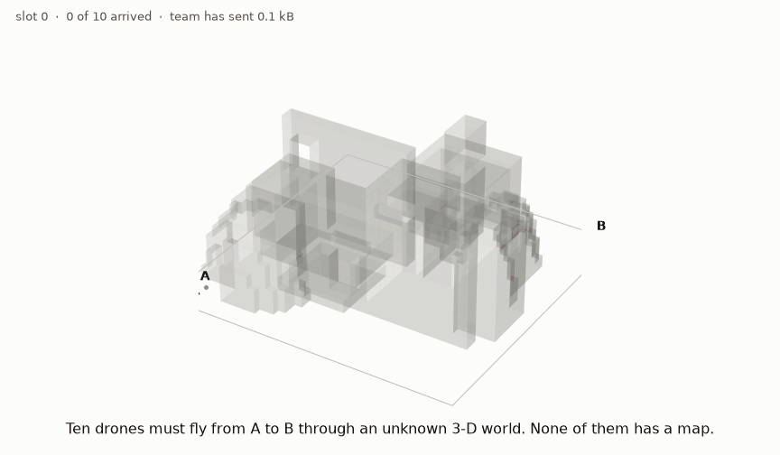
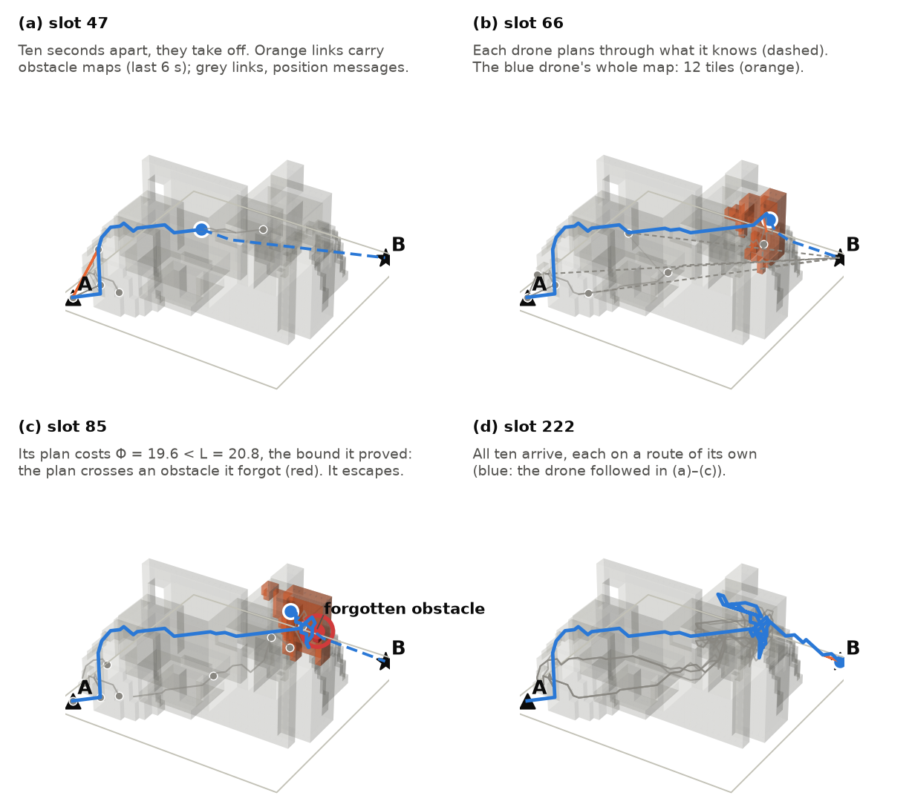
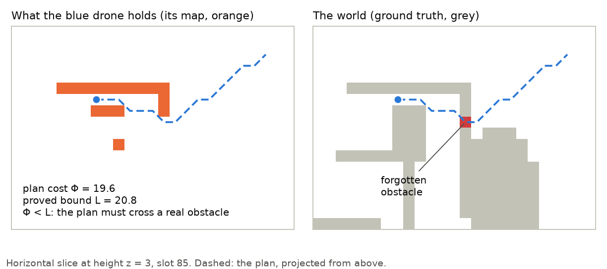
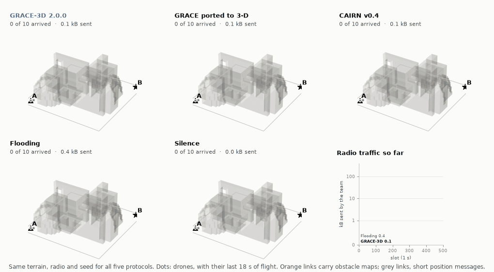
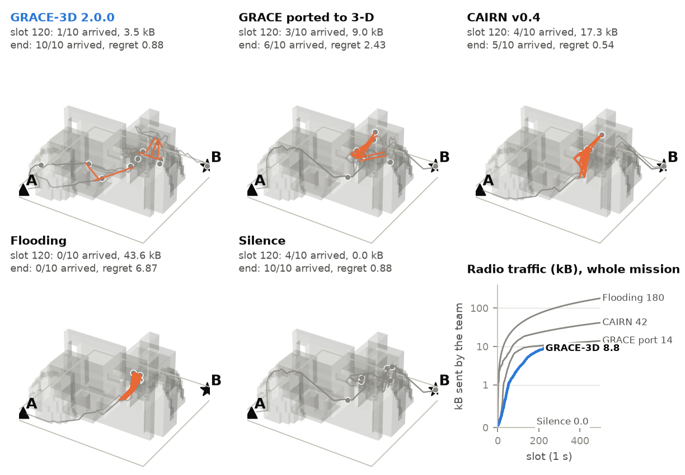
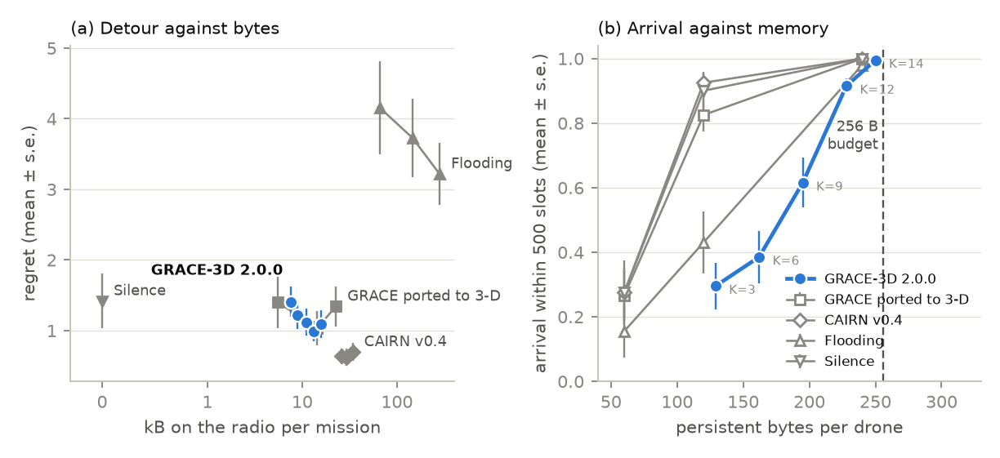
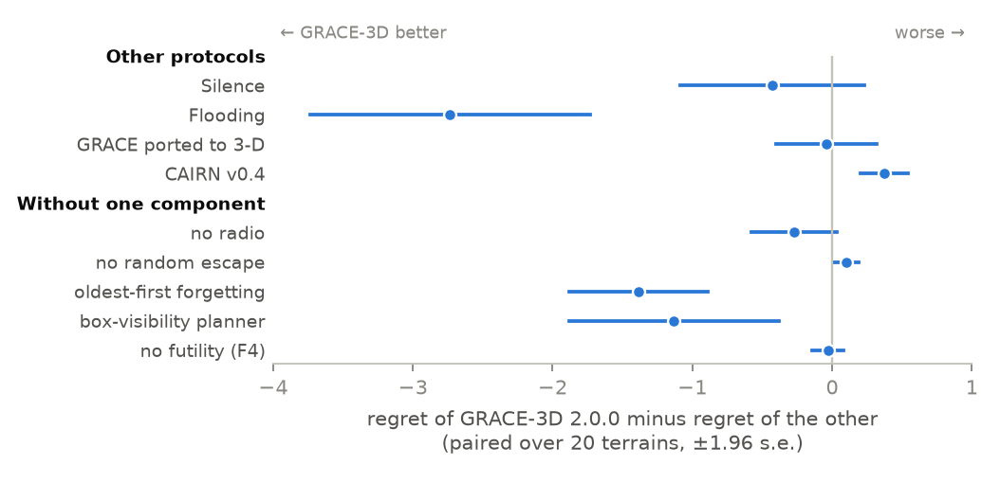

# GRACE-3D 2.0.0: Goal-Relevant Adaptive Compressed Exchange in three dimensions

*Navigating unknown voxel worlds and telling teammates only what changes their decision, with 228 bytes of state, one millisecond per slot and no global coordinates.*

Ropera Labs · Technical report RL-TR-2026-04 · swarm-dil v2.0.0 · November 2026

📄 Typeset version with every proof: [TECH_NOTE_v2.pdf](TECH_NOTE_v2.pdf) (LaTeX source [TECH_NOTE_v2.tex](TECH_NOTE_v2.tex)).

**Scope.** Mathematical changelog from GRACE (RL-TR-2026-03, swarm-dil v0.3.0) to GRACE-3D 2.0.0 ("v2" below). For each claim: its hypotheses and complete proof (`docs/v2_proofs.md`), its Lean 4 mechanisation (`formal/v2_theorems.lean`, no `sorry`), its symbolic, exhaustive or Monte Carlo check (`tests/math_verify_v2.py`), and its measurement (`benchmarks/`). Specification: `docs/v2_spec.md`. Simulation only.

## 1. Problem and contributions

**Operational setting.** GRACE (RL-TR-2026-03) derived what memory-limited agents crossing unknown terrain should tell each other, on a two-dimensional grid. GRACE-3D 2.0.0 asks whether that principle survives three dimensions on the budget of a small flight controller. A team of $N=10$ agents crosses an unknown voxel world from A to B. Each agent has 256 bytes of persistent state, one millisecond of a 168 MHz Cortex-M4 per one-second slot, two 8×8 time-of-flight zone sensors, and a radio whose packet header may carry no global coordinate.

**Design principle.** As in GRACE, an agent plans as if the unknown were free, so only obstacles can change its plan, and only obstacles are stored and sent. What is new is that a 256-byte agent must forget, and forgetting must neither trap an agent nor mislead it: every search proves a lower bound on the true distance; a tile is evicted only if it cannot change the current plan; a plan cheaper than the proved bound exposes a harmful eviction; and a random escape keeps arrival certain, with probability one, whatever is forgotten or received.

**Contributions.**

1. The exact distance of the 26-connected lattice in closed form, and canonical segments that realise it within one voxel of the straight line (H.1–H.5, T2.5a).
2. A 4×4×4 tile code within a constant factor of the information bound, whose merge is a bitwise OR that commutes with translation, so maps need no global frame (T2.1, T2.3); and a 15-bit wrapped pose that decodes exactly after up to 15 slots of silence (T2.4).
3. An ingestion cost whose reading term every correct agent must pay (T2.2).
4. Exact replanning in a fixed arena by an A* sliced over slots, whose every intermediate value is a sound lower bound, and a forgetting rule that cannot change the current plan (T2.6, T2.7).
5. Arrival with probability one for any memory bound and any received content, deterministic arrival along a verified route, and the impossibility of deterministic completeness with finite state (T2.8–T2.10); and a futility trigger, proved sound and adopted by a pre-registered paired test (F45.1–F45.6, §7).
6. The protocol itself, in 228 bytes and at most 124 954 modelled cycles per slot, and a paired study on 20 terrains against GRACE ported to 3-D, CAIRN v0.4, flooding and silence (§5).

**Related work.** No finite automaton searches every finite plane labyrinth (Budach 1978; see also Hoffmann 1981); every $K$-state automaton has a planar trap with at most $K+1$ nodes (Fraigniaud et al. 2005); two cooperating automata are reported to suffice in the plane (Blum and Kozen 1978); deterministic log space decides undirected connectivity (Reingold 2008); and a random walk covers every connected graph (Aleliunas et al. 1979). In three dimensions the range-sensor algorithm 3DBug is globally convergent, but it ends up holding the whole obstacle surface that blocks it (Kamon, Rimon and Rivlin 2001), so its memory grows with the obstacle. Incremental replanning (Ramalingam and Reps 1996, D* Lite) keeps a distance per vertex, $\Theta(\lvert\Omega\rvert)$ state, while A* run from the current state needs only scratch memory. Merges that tolerate duplication and reordering are joins of a semilattice, as in conflict-free replicated data types (Shapiro et al. 2011). Multizone time-of-flight sensors already drive obstacle avoidance on a Crazyflie 2.1 with a 168 MHz STM32F405, in 210 µs per frame (Müller et al., arXiv:2208.12624); that sensor and processor set the hardware model here. To our knowledge, no prior work bounds the memory of an optimistic planner that forgets, uses its searches' lower bounds as the certificates it communicates, or sends a few-byte header with no absolute coordinate. Full references are in the PDF.

The targets set for v2, the result that meets each, and where it is proved or measured:

| v2 target | Result | Where |
|---|---|---|
| 3-D space, information efficiency $\eta=O(1)$ against 2-D | 26-connected lattice with its exact metric $h_3$; 4×4×4 tiles at 0.625 B per surface voxel in expectation, 0.641 B measured; $\eta_{3D}/\eta_{2D}=$ 1.05 | H.1–H.5, T2.1, C1 |
| perception $O(\lvert\Delta O_{\rm visible}\rvert)$ | $P$ zone reads, which every correct agent needs (adversary bound), plus $\lvert\Delta O\rvert$ bit inserts; 1 456 cycles at p99 | T2.2, C2 |
| incremental replanning in ≤ 256 B and < 1 ms | exact A* on the believed lattice, sliced over slots on a frozen map, each search a sound lower bound on the true cost; 228 B of persistent state; at most 124 152 of 168 000 cycles per slot, no overrun in 43 406 agent-slots | T2.6, T2.7, T2.11, C3 |
| header without GNSS, 0 B of global coordinates | 5-byte header with a 15-bit wrapped pose, decoded exactly after up to 15 slots of silence | T2.3, T2.4, C4 |
| completeness | arrival with probability 1 for any memory bound and any received content; deterministic along a verified route; deterministic completeness with finite state is impossible | T2.8–T2.10 |

Cycles come from a declared operation-count model of a 168 MHz Cortex-M4 (§6), not from hardware.

### How it works, in plain words

Ten drones leave A ten seconds apart and must reach B through a world none of them has seen. Each has a short-range depth sensor (5 voxels, 25 m), a weak shared radio, 256 bytes of memory and one millisecond of a small processor per second. Eight ideas make that enough (the PDF gives the exact rules as pseudocode, and the proofs):

1. **Plan as if the unknown were free.** A drone plans the shortest route to B assuming every voxel it does not know to be blocked is free. Learning that a voxel is free could then never change its plan, so memory and radio carry obstacles only.
2. **Every search proves a lower bound.** The obstacles a drone holds are real, so the shortest route through its map is never longer than the true one: each search proves a number L with L ≤ V\*, the true remaining distance. After a step of length c, L − c is still a bound.
3. **Twelve tiles of map, and a rule for what to forget.** Obstacles are stored in 4×4×4-voxel tiles of 10 bytes, at most 12 per drone. When a thirteenth arrives, the drone evicts the tile farthest outside the region a route as cheap as its plan could pass through; such a tile cannot change the plan.
4. **An exact search that fits in one millisecond.** A* expands as many nodes as fit in 70 % of each second's budget while the drone hovers on a frozen map, and resumes the next second. Even unfinished, its lowest estimate is already a valid bound.
5. **A plan too cheap to be true.** If the plan's cost Φ is below the proven bound L, the plan cannot be a real route: it must cross a real obstacle, and with honest maps that happens only after an eviction. The drone drops the plan and escapes at once.
6. **Never stuck for ever.** When a decision makes no progress and nothing new was learned, the drone starts, with probability 5 %, a correlated random walk lasting four seconds on average. This guarantees arrival with probability one, whatever the memory size and whatever teammates say.
7. **Tell teammates only what changes their route.** A drone offers a tile only if it refuted one of its own plans, and sends it only if the detour it would save teammates still flying is worth its 10 bytes. Every 10 seconds it also announces its cell and next two waypoints.
8. **No global coordinates on the radio.** Positions are counted from A by dead reckoning; a packet carries its sender's position modulo 32 voxels per axis, which the receiver decodes exactly if it heard the sender within 15 seconds. Maps merge by bitwise OR, so order, repetition and relaying never matter.

## 2. Model: what changed from v1

| | GRACE (2-D) | GRACE-3D 2.0.0 (3-D) |
|---|---|---|
| world | grid, 8-connected, octile metric | 40×40×10 voxels of 5 m, 26-connected; $h_3(d)=\delta_1+(\sqrt2-1)\delta_2+(\sqrt3-\sqrt2)\delta_3$ ($\delta$ the sorted $\lvert d_i\rvert$), exact on the empty lattice |
| terrain | ridges, pockets | towers, walls with one window, roofed pockets open towards A, floating slabs, mounds |
| sensing | vision cone of rays | two 8×8 time-of-flight zone arrays of 60°, one along the heading, one sideways (rotating), first hit per zone |
| map | 4×4 tiles of 4 B | 4×4×4 tiles: 2 B key + 64-bit mask; at most $K=12$ |
| state | hundreds of bytes | 228 B persistent + 16 KiB scratch arena |
| frame | grid coordinates | relative to A by dead reckoning; pose on the wire modulo 32 |
| compute | unbounded | 168 000 cycles per 1 s slot: 1 ms of a 168 MHz Cortex-M4F (STM32F405 class) |
| radio | v0.2 physical model | the same model with 3-D line of sight; 9.6 kbit/s, 64 B per packet |

**Isolation (Definition 1).** `src/sim3d/agent.py` imports only `math`, `random`, `dataclasses` and the on-board modules `wire`, `geom`, `ops` (AST test `test_agent_is_isolated`). It is told its mission order, the zone hits as offsets from itself, whether its last move happened, and the raw bytes it receives.

## 3. One slot of an agent

| Step | Rule | Result |
|---|---|---|
| 1 ingest | each zone hit sets one bit of its tile | T2.2 |
| 2 receive | unwrap poses; OR-merge tiles; PLAN re-anchors a teammate, TEAM raises the team bound, VERIFIED chunks assemble a route | T2.3, T2.4 |
| 3 forget | above $K$ tiles, evict the untouched tile with the largest informed-set margin | T2.7 |
| 4 plan | when one of the next 2 plan pieces is blocked, or the plan is spent: exact A* on the believed lattice, up to 70 % of each slot, map frozen meanwhile; the path is compressed into canonical segments $\sigma$; the box-visibility planner only on arena overflow | T2.5a, T2.5, T2.6 |
| 5 certify | each completed search raises $L_i\leftarrow\max(L_i,d_K(p_i))$; moves transport $L_i$ | T2.0, T2.6 |
| 6 escape | no progress and nothing fresh: escape with probability 0.05; no plan, or a futile plan ($\Phi<L_i$): escape surely. Correlated random walk, $\rho=0.25$, mean length 4 | T2.9, F45.1–F45.3 |
| 7 send | VERIFIED, TEAM and PLAN claims; then pool tiles worth at least $10\kappa$ to travelling teammates, at most once every 8 slots each | v1 Prop. 1, Thm. 1 |
| 8 move | one step along $\sigma$; the walk record stays a verified route of at most 12 waypoints | T2.8, Lemma 8.1 |

## 4. Results

Every statement below is proved in full, with its hypotheses, in `docs/v2_proofs.md`.

| | Statement | Lean | Check |
|---|---|---|---|
| H.1–H.5 | $h_3$ is a norm, the maximum of 6 weighted forms; every walk costs at least $h_3$ of its displacement; consistency | `hmax_subadd`, `hmax_zero`, `h3_weights`, `consistent`, `disp_le_walkCost` | `test_h3_is_lattice_distance`, `test_h3_weights_and_rearrangement` |
| T2.0 | bound monotonicity, union, sandwich, commit regret ≤ θ, transport | `dist_mono`, `dist_union`, `sandwich_lower`, `sandwich_upper`, `commit_regret`, `transport` | `test_informed_and_anytime` |
| T2.1 | an injective code needs $a$ bits for some $a$-voxel height field; tiles use $5a$ bits aligned, at most $10(1+6/m)^2a$ at any offset; real optimum side $32^{1/3}$ | `code_length` | `test_surface_code` |
| T2.2 | ingestion = $P$ reads + $\lvert\Delta O\rvert$ inserts; any correct agent reads every zone whose ray holds a voxel not known blocked | — (adversary argument) | C2 |
| T2.3 | merging commutes with translation and re-tiling; masks merge by OR (a join semilattice) | `translate_merge`, `retile_merge`, `retile_cover`, `retile_translate`, `mask_or_*` | `test_zero_global_coordinate_bytes` |
| T2.4 | the wrapped pose decodes exactly iff $-16\le p-\hat p<16$ per axis, so after up to 15 slots of silence | `unwrap_eq_iff`, `unwrap_of_recent` | `test_unwrap` (exhaustive and Z3) |
| T2.5a | $\sigma$ (nested Bresenham) takes unit steps, costs exactly $h_3$, stays within $\ell_\infty$ distance 1 of the straight segment | — | `test_segment_exhaustive` (every $\lVert d\rVert_\infty\le10$), `test_segment_box_corollary` |
| T2.5 | box-visibility plans are walks of the believed graph; work independent of $\lvert\Omega\rvert$; not complete | — | `test_bvp_returns_walks_of_the_believed_graph` |
| T2.6 | every value read from a sliced A* is $\le d_K\le V^\star$, non-decreasing, exact at completion | `consistent`, `walkCost_split`, `fmin_sound` | `test_informed_and_anytime`, `test_astar_arena_bound_is_sound` |
| T2.7 | a tile outside the informed set $\mathcal E(x,B,U)$ changes no plan of cost ≤ U | `informed`, `forget_safe`, `informed_h3` | `test_informed_and_anytime` |
| T2.8 | a verified route of at most 12 waypoints reaches B deterministically without map memory; regret ≤ θ when committed | `commit_regret` | `test_checked_mission` |
| T2.9 | B is reached with probability 1 for any $K\ge1$ and any received content; an escape succeeds with probability $\ge(\rho(1-1/\mu)/52)^L$ | `fail_bound`, `fail_tendsto` (counting step) | `test_liveness`, C3 liveness |
| T2.10 | no finite-state deterministic single agent finds B in every finite 3-D world (Budach's theorem, embedded); $O(\log\lvert\Omega\rvert)$ bits suffice (Reingold) | — (reduction) | — |
| T2.11 | persistent state 228 B ≤ 256 B | `memory_budget` | `test_memory_layout`; asserted at every slot |
| F45.1 | a plan cheaper than a sound bound, $\Phi<L$, enters a blocked voxel | `futile_crosses` | `test_futility_invariant` |
| F45.2 | with honest maps and no eviction, $L\le d_K(p)$ holds throughout: futility certifies harmful forgetting | `inv_search`, `inv_move`, `inv_learn`, `no_futility` | `test_futility_invariant` |
| F45.3 | the futility trigger keeps T2.9 | `fail_bound` | C3 liveness |
| F45.6 | first arrival $T_1\ge\lVert B-A\rVert_\infty$; with launches every Δ slots, $N-(\lfloor(T_1+\delta)/\Delta\rfloor+1)$ agents at most can commit | `reach_time`, `commit_count` | §5 |

Lean 4.36 with Mathlib v4.36.0 (`lake build` in `formal/`); every theorem depends only on the axioms `propext`, `Classical.choice` and `Quot.sound`.

## 5. Measurements

**The swarm at work.** One recorded mission (seed 2; regret 0.88, against a mean of 0.99 over the 20 terrains), following one drone (blue) among its nine teammates (grey). Orange radio links carry obstacle maps, grey links short position messages; the blue drone's whole map is the 12 tiles drawn in orange. At slot 85 its plan becomes cheaper than the bound it has proved, which means the plan crosses an obstacle it has just evicted (red), and it escapes.







**Against the other protocols, on the same terrain.** Flooding saturates the channel, silence sends nothing, and GRACE-3D 2.0.0 sends the least of those that talk. One terrain says little on its own: here silence also brings all ten drones home with the same regret as GRACE-3D 2.0.0 (0.88), while over the 20 terrains its regret is 1.42 against 0.99. The paired statistics follow.





**The two main planes**, each point a mean over the same 20 terrains with ±1 standard error over those paired seeds (`benchmarks/sweep_v2.py`): detour against bytes, along the fronts traced by the price κ (and by flooding's packet budget); and arrival against persistent memory.



**Reading the planes.** (a) The price sweep of GRACE-3D 2.0.0 (κ = 4, 2, 1, 0.5, 0.25 from left to right) runs from 7.6 to 15.7 kB per mission. Its regret is lowest at the default κ = 0.5 (0.99 ± 0.14 at 13.3 kB): spending more does not lower it (1.09 ± 0.20 at 15.7 kB), and spending less raises it to 1.41 ± 0.21 at 7.6 kB. GRACE ported to 3-D lies in the same band (1.03 ± 0.24 at 14.3 kB, 1.34 at 22.7 kB, 1.40 at 5.5 kB), so these 20 terrains do not separate the two fronts. CAIRN v0.4 reaches 0.62–0.70 with 26–34 kB, below every point of the GRACE-3D sweep: its advantage cannot be bought with bytes, which agrees with its source being the relay of verified routes (F45.6). Flooding needs 66–281 kB and stays above 3.2; silence costs 1.42 with no byte. (b) With K = 3, 6, 9, 12, 14 tiles GRACE-3D 2.0.0 keeps 129 to 250 B in total, and its arrival within 500 slots rises from 0.30 to 0.995. Below 9 tiles an agent cannot hold the obstacles around it, and most agents are still flying at slot 500 (they arrive later, as T2.9 guarantees: 87 % within 5000 slots at K = 6). At the default 12 tiles arrival is 0.915; at 14 tiles, 250 B, it is 0.995 ± 0.005 with a regret of 0.73 ± 0.10. The baselines' points count only their map (hollow): with 120 B of map they reach 0.83–0.93 (flooding 0.43), with 240 B all of them arrive (flooding 0.98), and with 60 B they all fall to 0.15–0.28. Their remaining state is not bounded, so the horizontal positions are not comparable byte for byte, while GRACE-3D's include everything. K = 12 was fixed by the specification before this sweep; K = 14 is left to the next version (§8).



20 paired terrains (seeds 0–19): every configuration runs on the same terrains, links and sensors. Ten agents launch 10 slots apart; missions last 500 slots unless stated. Regret is the mean over agents of the distance flown, plus the true distance left if not arrived, over the true shortest distance, minus one. Baselines from v0.4 get 120 B of map memory (their other state is not bounded); GRACE-3D 2.0.0 keeps 228 B in total. "v2 minus it" is the paired difference in regret (`benchmarks/v2_results.json`).

**How two configurations are compared.** Let $R_X(s)$ be the regret of configuration $X$ on terrain $s$, the mean over its ten agents. Every configuration flies the same $n=20$ terrains, so the comparison is made terrain by terrain:

$$d_X(s)=R_{\rm v2}(s)-R_X(s),\qquad \bar d_X=\frac1n\sum_{s=1}^{n}d_X(s),\qquad \mathrm{se}_X=\frac{1}{\sqrt n}\Big(\frac{1}{n-1}\sum_{s=1}^{n}\big(d_X(s)-\bar d_X\big)^2\Big)^{1/2},$$

and the forest plot draws $\bar d_X\pm1.96\,\mathrm{se}_X$; a negative $\bar d_X$ means that GRACE-3D 2.0.0 detours less than $X$. Pairing removes what the two runs share, the terrain: the regret of GRACE-3D 2.0.0 alone ranges from 0.20 to 2.21 across terrains (s.d. 0.64), CAIRN v0.4's spreads with s.d. 0.55, and yet their paired differences spread with only 0.39. For the same reason the planes must not be read by overlapping bars: there each bar is the s.e. of one mean, $\mathrm{sd}(R_X)/\sqrt n$, which still contains the terrain spread, so two points whose bars overlap may differ clearly once paired. Each interval covers one comparison. With the $t$ quantile for 19 degrees of freedom (2.09 instead of 1.96) no interval changes side of zero; with Holm's correction for the nine comparisons at family level 0.05 (paired $t$-tests), four differences remain: oldest-first forgetting, flooding, CAIRN v0.4 and the box-visibility planner.

**Reading the forest plot: other protocols.** *Flooding* detours 2.74 more than GRACE-3D 2.0.0 (95 % interval 1.73 to 3.74; worse on 17 of the 20 terrains) while sending 11 times the bytes, and only 43 % of its agents arrive within 500 slots. *Silence* (the v0.4 agent with 120 B of map) detours 0.43 more on average, but the interval runs from −1.08 to +0.23 and GRACE-3D 2.0.0 is better on only 10 of the 20 terrains. Talking does not help on every terrain; it removes the bad ones: on its worst terrain silence reaches a regret of 6.73 against 2.21, and its 95th percentile is 4.56 against 2.15. *GRACE ported to 3-D* has the same regret (−0.04, interval −0.40 to +0.32; GRACE-3D 2.0.0 is lower on 6 of the 20 terrains), but GRACE-3D 2.0.0 brings 9 percentage points more of its agents home (0.915 against 0.825; paired difference 0.090 ± 0.040 s.e.), sends 7 % fewer bytes and keeps its whole state in 228 B, where the port is given 120 B of map and an unbounded rest. *CAIRN v0.4* detours 0.37 less than GRACE-3D 2.0.0 (interval 0.20 to 0.54; lower on 18 of the 20 terrains) and arrives as often (0.925 against 0.915), at 2.2 times the bytes and with its state beyond the map unbounded. Its advantage is that it relays verified routes in flight, which v2 does not do (F45.6 and §8).

**Reading the forest plot: components.** *Goal-relevant forgetting* is the largest single effect: oldest-first eviction instead adds 1.38 of regret (interval 0.89 to 1.88), on every one of the 20 terrains, and arrival falls from 0.915 to 0.615. With 12 tiles, which tiles stay matters more than anything else measured here. *The exact sliced A\** saves 1.13 against the box-visibility planner (interval 0.38 to 1.88; 17 of the 20 terrains), which is also the only planner that overruns the slot (below). *The radio*, against the same agent without it, removes 0.27 of regret on average and helps on 13 of the 20 terrains, but its interval (−0.58 to +0.03) includes zero: 20 terrains do not separate this effect from chance. *The random escape trigger* costs 0.10 (interval 0.01 to 0.19; $p=0.042$, not significant after Holm's correction). It is kept because T2.9 rests on it: without it, an agent whose plan neither shortens nor meets anything new never escapes, and on 40 random 10×10×3 worlds a reduced agent with the rule of step 6 ($K=2$) cycles for ever in 15 of them without escapes, while it arrives in all 40 with them (`test_liveness`). In this bench the agents without it arrive as often (0.910 against 0.915), so the bench measures the price of the guarantee, not its benefit. *Futility* changes the regret by −0.03 (interval −0.14 to +0.08) at $K=12$ and 500 slots: it was adopted for its byte saving (§7), and it acts where memory is tight: with $K=6$, 87 % of the agents arrive within 5000 slots against 65 % without it.

| Configuration | regret, mean ± s.e. | p95 | p99 | arrival | kB per mission | v2 minus it |
|---|---|---|---|---|---|---|
| **GRACE-3D 2.0.0** | 0.991 ± 0.144 | 2.15 | 2.19 | 0.915 | 13.3 | — |
| v2 without radio | 1.263 ± 0.204 | 2.98 | 3.00 | 0.880 | 0.0 | -0.272 ± 0.155 |
| v2 without the random escape trigger | 0.892 ± 0.137 | 1.93 | 2.21 | 0.910 | 12.7 | +0.099 ± 0.045 |
| v2 with oldest-first forgetting | 2.374 ± 0.324 | 4.70 | 5.08 | 0.615 | 15.6 | -1.383 ± 0.253 |
| v2 with the box-visibility planner | 2.122 ± 0.499 | 6.12 | 6.77 | 0.855 | 13.2 | -1.131 ± 0.383 |
| v2 without futility (the F4 agent) | 1.020 ± 0.162 | 2.37 | 2.48 | 0.885 | 13.9 | -0.029 ± 0.057 |
| GRACE ported to 3-D, 120 B of map | 1.030 ± 0.242 | 3.18 | 3.83 | 0.825 | 14.3 | -0.039 ± 0.184 |
| CAIRN v0.4, 120 B of map | 0.620 ± 0.123 | 1.87 | 2.29 | 0.925 | 29.5 | +0.371 ± 0.087 |
| flooding, 120 B of map | 3.726 ± 0.556 | 6.97 | 7.65 | 0.430 | 146.1 | -2.735 ± 0.511 |
| silence (v0.4 agent), 120 B of map | 1.418 ± 0.386 | 4.56 | 6.30 | 0.900 | 0.0 | -0.427 ± 0.335 |
| silence, unbounded map | 0.781 ± 0.082 | 1.33 | 1.43 | 1.000 | 0.0 | — |
| v2 with K = 6 tiles (60 B of map) | 2.985 ± 0.352 | 5.34 | 5.71 | 0.385 | 13.7 | — |

**Reading the tables.** *regret* is the mean of $R_X(s)$ over the 20 terrains ± its s.e., $\mathrm{sd}(R_X)/\sqrt{20}$; *p95* and *p99* are percentiles of the 20 per-terrain regrets, interpolated linearly: with 20 values, p95 is essentially the second-worst terrain and p99 lies close to the worst; *arrival* is the share of the 200 agents (10 per terrain) at B within 500 slots; *kB* counts every byte the team put on the radio during one mission, headers included; *v2 minus it* is $\bar d_X\pm\mathrm{se}_X$. Silence with an unbounded map shows what perfect memory achieves without any radio (0.78, every agent home); v2 with $K=6$ shows the cost of halving the map: 38.5 % arrive within 500 slots. In the second table, C1 first divides the tile bytes sent (10 per tile) by the obstacle voxels those tiles carry, the set bits of their masks: 0.641 B, i.e. 15.6 obstacle voxels per tile. C1 then compares the information efficiency $\eta_{3D}=(\bar R_{\text{v2 without radio}}-\bar R_{\rm v2})/\mathrm{kB}_{\rm v2}=0.0204$ regret removed per kB with v1's 0.013–0.026 per kB (midpoint 0.0195). Its numerator is the radio effect above, whose interval includes zero, so within ±1 s.e. the ratio 1.05 is only known to lie between 0.45 and 1.65. C2 takes, in each mission, the 99th percentile over slots of the cycles spent in step 1 (ingesting the sensor scan), and reports the 99th percentile of those over the 20 missions. C3 is the worst slot over the 20 missions of GRACE-3D 2.0.0, its persistent state and its arrival; C4 checks that shifting every position by a multiple of 32 voxels leaves every byte on the wire unchanged (T2.3, T2.4). The verified-route fit rate is the share of arrived agents whose flown path fits the 12-waypoint record: 9.3 %, and F45.6 explains why such routes are never used in this schedule.

| Constraint | Value | Target | Met |
|---|---|---|---|
| C1 tile bytes per obstacle voxel carried | 0.641 | ≤ 0.7 | yes |
| C1 η3D/η2D (regret removed per kB, against v2's own silence) | 1.048 | ≥ 0.5 | yes |
| C2 step-1 cycles per slot, p99 | 1 456 | < 20 000 | yes |
| C3 cycles per slot, maximum | 124 152 | < 168 000 | yes |
| C3 persistent state, bytes | 228 | ≤ 256 | yes |
| C3 liveness: arrival within 20 000 slots, K = 12 | 1.0 | 1.0 | yes |
| C3 stress: arrival within 5000 slots, K = 6 | 0.87 | report | — |
| C3 arrival within 500 slots, K = 12 | 0.915 | report | — |
| C3 arrival within 500 slots, K = 6 | 0.385 | report | — |
| C3 verified-route fit rate | 0.093 | report | — |
| C4 global-coordinate bytes on the wire | 0 | 0 | yes |

Every configuration of GRACE-3D 2.0.0 in the bench (with and without radio, without the random trigger, with oldest-first forgetting, with $K=6$, and the 20 000- and 5000-slot runs) stays within 124 954 cycles per slot over 694 326 agent-slots, with no overrun, and within 228 B. Only the ablation that runs the box-visibility planner alone, in one slot, overruns (1 588 of 40 264 agent-slots, up to 396 460 cycles): that is why v2 slices an exact search over slots instead. Every one of the 200 agents arrives within 20 000 slots ($K=12$); with 6 tiles, 87 % arrive within 5000 slots, against 65 % for the F4 agent.

## 6. How the embedded figures are counted

**Memory.** `Agent.memory_used` recomputes this layout from the live state of the agent; the checked mission asserts it is at most 256 B at every slot (`test_checked_mission`), and the benchmark records the peak over all agents and slots.

| Structure | Bytes |
|---|---|
| 12 tiles × (2 B key with the pool bit + 8 B mask) | 120 |
| plan: 8 waypoints × 2 B | 16 |
| bounds $L_i$, $\Phi$, team $V(A)$, verified $U$: 4 × 2 B | 8 |
| pose 2, heading 1, sequence 1, escape 1, random state 2, segment step 1 | 8 |
| eviction Bloom filter | 4 |
| 9 teammates × (pose 2, last heard 1, flags 1) | 36 |
| walk record: 12 waypoints × 2 B | 24 |
| tile send age: 12 × 1 B | 12 |
| **total** | **228** |

Everything else (A* open and closed sets, the box-visibility graph, packet buffers) lives in a 16 KiB scratch arena: a search holds at most 2048 nodes and stops before an expansion that would overflow it, so the value read last is still a sound bound (T2.6).

**Bytes on the wire.** Packets are encoded bit-exactly (spec §4: 5 B header; a claim takes 4 B plus 3 B per waypoint; a tile 10 B), and the encoded length is what the radio carries and what is counted. Z3 proves that packing and unpacking of every header and claim word are inverse for all field values (`test_wire_layout_z3`); 3000 random packets equal an independent encoder written from the specification table, and every truncation is rejected (`test_wire_bit_exact_and_roundtrip`); shifting the pose by any multiple of 32 voxels leaves the bytes unchanged (`test_zero_global_coordinate_bytes`).

**Cycles.** Each primitive is counted inside the agent and priced at a declared Cortex-M4 cost (`src/sim3d/ops.py`): bit test 4, hash or heap operation 30, segment–box slab test 40, segment step 8, relaxation 12, $h_3$ 20, byte handled 2. A slot has 168 000 cycles (1 ms at 168 MHz). The prices are an estimate to be calibrated against a C port of steps 1 and 4; Python wall time is never used. One A* expansion costs at most $30+26(12+30+4+30+20)=2526$ cycles, and the search stops once 70 % of the slot is spent. The remaining 30 % covers every compression measured, but it is not a worst-case guarantee (F4.5 audit).

## 7. F4.5: one post-empirical pass

The F4 agent was audited constant by constant (`docs/v2_proofs.md`, F4.5.0). Two mechanisms that F4 left unused became candidates, each proved, mechanised and checked before it ran: a *futility trigger* (F45.1–F45.3: a plan cheaper than the sound bound $L_i$ certainly crosses a forgotten obstacle, so escape at once) and the *v1 loss model* in tile selection (F45.4–F45.5: Gilbert–Elliott loss after hearing, $\pi_B(1-\lambda^\tau)$, and an exact scalar collapse of the per-receiver beliefs). Rule fixed before the runs: 40 paired seeds (20 main, 20 unseen), adopt only a significant improvement of a Pareto metric (paired $t$-test, $p<0.05/3$, the same sign on both halves) that degrades nothing.

| Against F4 | regret | bytes per mission | outcome |
|---|---|---|---|
| futility | −0.072 ± 0.044 ($p=0.11$) | −1 011 ± 362 ($p=0.008$) | **adopted** |
| loss model | +0.081 ± 0.048 ($p=0.10$) | −2 422 ± 681 ($p=0.001$) | passed alone; rejected by the composition rule |
| futility, $p_{\rm esc}=0.01$ | −0.125 ± 0.060 ($p=0.044$) | −1 156 ± 435 ($p=0.011$) | passed; not separable from $p_{\rm esc}=0.05$, which changes no constant |
| loss + futility | +0.115 ± 0.065 ($p=0.087$) | −2 428 ± 742 ($p=0.002$) | regret +0.186 ± 0.060 against futility alone ($p=0.004$): rejected |

The link counters that only the loss model would have read were deleted (255 → 228 B). On the final code the F4 agent (`v2-nofutile`) and both futility variants reproduce all 120 evaluation missions exactly, memory aside. About 69 % of futility's byte saving comes from shorter travel (110 fewer agent-slots before arrival per mission), the rest from a lower rate. A likely reason why the loss model fails, not tested: it assumes that receivers keep a tile once they have it, while receivers with 12 tiles evict, and the fixed 8-slot resend re-supplies what they evicted.

## 8. Limitations and next steps

- **Local repair (a deviation from target 3, "$O(k\log k)$ local repair"):** incremental search in the Ramalingam–Reps sense needs a stored distance map, $\Theta(\lvert\Omega\rvert)$ state, which does not fit in 256 B. v2 instead re-plans exactly from scratch in the scratch arena, spread over slots; a search expands 208 nodes at the median and 940 at p99, and fits the arena in 99.6 % of searches (6 missions, 3 376 searches).
- **Completeness:** deterministic completeness with finite state is impossible for a single agent (T2.10). v2 claims probabilistic completeness (T2.9) and deterministic completeness along a verified route (T2.8). The bound of T2.9 is exponentially small in the trap size: it proves liveness, not speed (§5, $K=6$).
- **Verified routes are never used in this schedule** (F45.6): routes do not reach A before the last launch, because they travel one hop. Relaying them, or adopting routes in flight, is what CAIRN v0.4 does and what its lower regret reflects; it is the v3 item.
- **Tile budget:** K = 14 tiles (250 B) brings 99.5 % of the agents home within 500 slots against 91.5 % at the specified K = 12; adopting it needs the same pre-registered paired test as F4.5.
- **Cycles are a model**, not a measurement on a microcontroller: no C port exists yet, and the claim of no dynamic allocation in the slot loop is a property of the fixed layout and arena, not of the Python simulator.
- **Synthetic world:** procedurally generated terrain, simulated radio, exact sensing and odometry, static obstacles, honest teammates.

## 9. Reproduce

```
pip install -e ".[test]"
pytest -q                          # unit tests and math checks (tests/math_verify_v2.py)
cd formal && lake exe cache get && lake build && cd ..
python benchmarks/eval_v2.py       # 20 paired seeds -> benchmarks/v2_results.json, v2_runs.csv
python benchmarks/f45_v2.py        # F4.5 decision -> benchmarks/v2_f45.json, v2_f45_runs.csv
python benchmarks/f45_commit_reach.py   # Prop. F45.6 (c) -> benchmarks/v2_f45_commit.json
python benchmarks/sweep_v2.py      # the two planes, 540 missions -> benchmarks/v2_sweep.json, v2_sweep_runs.csv
python experiments/v2_media.py     # every figure, both GIFs and docs/replay3d.json
```

Seeds are fixed, so every figure above is reproduced exactly. With `pytest-xdist`, `pytest -n 5` runs the tests in parallel.

## Responsible use

Open, basic research by Ropera Labs on information-efficient coordination of autonomous systems over degraded networks, aimed at dual-use applications such as search and rescue, emergency response and infrastructure inspection. Only synthetic data; no weapon, targeting or vehicle-specific control code. Please use it in line with international humanitarian law and your local regulations.
